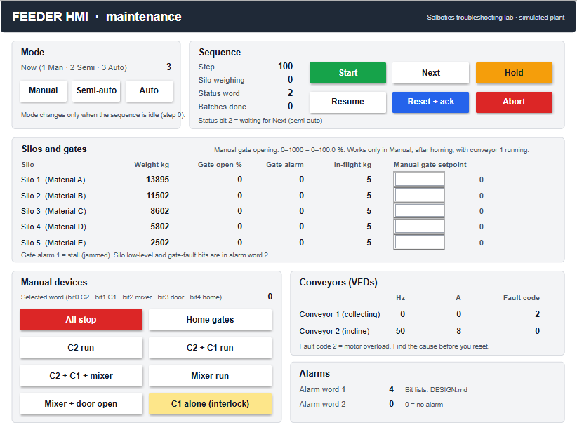

# PLC Troubleshooting Lab

**Learn how technicians find the real cause when an automated factory line stops, on a free virtual plant you can break and fix.**

## In one minute

- **What it is:** a small virtual factory that mixes five ingredients into batches. It weighs each one, carries them up two conveyor belts and mixes them, all run by a real factory controller (a PLC), the same kind of computer that runs most production lines.
- **Why it matters:** when a line stops, every minute costs output. The valuable skill isn't swapping parts until something works. It's **finding the real cause quickly, and proving the fix**.
- **What's inside:** seven realistic breakdowns. Each one is told as a short story with screenshots: what the operator saw, what the machine's own data showed, what was really wrong, and how it was fixed.
- **Who it's for:** anyone curious, students and newcomers to maintenance, and recruiters who want to see how I work.

> **Honest label:** a demonstration rebuilt with free tools. It isn't any company's program; the ingredients (A–E), recipes and numbers are invented.

## The story behind it (STAR)

**Situation.** I worked as a maintenance technician on production lines run by PLCs, including an automatic feeding and batching line in a dusty, humid, corrosive plant. When something stopped, I traced it: checking the signals, reading the program while it ran, checking the settings, and only then replacing parts. But the programs belonged to the company, so I couldn't show any of that work.

**Task.** Show my fault-finding method in a way **anyone can check**, and make it something **newcomers can practise on**, using only free software.

**Action.**
- Designed a realistic mini batching plant: five weighed silos, two conveyors, a mixer and two operator screens.
- Wrote the control program in the industry-standard PLC language (IEC 61131-3) and ran it on **OpenPLC**, a free PLC.
- Built a simulator of the machines, so the plant behaves like the real thing: belts, motors, gates, weighing and alarms.
- Recreated **seven faults based on the kinds of work I did in maintenance** (sensor checks, module swaps, drive checks, program and screen changes): a broken sensor cable, a replaced module with the wrong setting, an overloaded conveyor, a jammed gate, a broken output wire, a bad program change and a wrong screen setting.
- Wrote each one up step by step, with screenshots from the running system.

**Result.**
- A lab that runs on an ordinary laptop with free software, end to end: the program, the operator screens and the simulated plant.
- **Seven breakdowns** anyone can reproduce and follow, with **29 screenshots**.
- **37 automated tests** check that the plant runs a full batch correctly and that every fault behaves as described.
- A newcomer guide and glossary, so the method can be learned, not just admired.

## The seven breakdowns, in plain words

| | What the operator sees | What was really wrong | The lesson |
|---|---|---|---|
| [F1](faults/F1-sensor.md) | A silo suddenly "weighs" minus 5 000 kg | The weighing sensor's cable was broken | A strange number often means a broken signal, not a strange reality |
| [F2](faults/F2-module-address.md) | Everything stops and the screen freezes | A replaced part was set to the wrong address | When everything fails at once, look for the one thing they share |
| [F3](faults/F3-vfd-trip.md) | A conveyor keeps tripping | Jammed rollers made the motor work too hard | Resetting isn't fixing: find what made it trip |
| [F4](faults/F4-gate-stepper.md) | One silo's gate won't open | A lump of material jammed the gate | Fix the mechanical cause, then let the machine re-learn its position |
| [F5](faults/F5-output-wiring.md) | The controller says "open", but the door stays shut | A broken wire between the controller and the valve | Follow the electricity until it stops |
| [F6](faults/F6-program-edit.md) | No alarm, but the product comes out wrong | A copy-paste mistake in a program change | Machines do exactly what they're told; check every change before use |
| [F7](faults/F7-hmi-tag.md) | The screen says a silo is leaking, but it isn't | The screen was reading the wrong number | Check the source before believing the display |

The real plant conditions behind these (corrosion, dust, humidity, worn belts and motors) are on [this page](faults/REAL_WORLD.md).

## Where to start

| You are… | Start here | Time |
|---|---|---|
| **A recruiter or manager** | The table above, then one story: [F3, the conveyor that keeps tripping](faults/F3-vfd-trip.md) | 5 minutes |
| **New to maintenance, or a student** | [Start here: how troubleshooting works](docs/START_HERE.md), then the stories in the suggested order | 1 hour |
| **Unsure what a word means** | [Glossary](docs/GLOSSARY.md): every technical word in one plain sentence | — |
| **An engineer, or want to run it yourself** | [Setup and technical details](docs/SETUP.md), the [design](DESIGN.md) and the [PLC program](plc/batching.st) | — |

## Built with (all free)

[OpenPLC](https://github.com/thiagoralves/OpenPLC_v3) (the PLC) · [FUXA](https://github.com/frangoteam/FUXA) (the operator screens) · Python (the plant simulator). Code: MIT licence. Guides and pictures: CC BY 4.0. Free to use for learning and teaching.

*Made by Muhamad Solehuddin, [Salbotics](https://salbotics.uk).*
