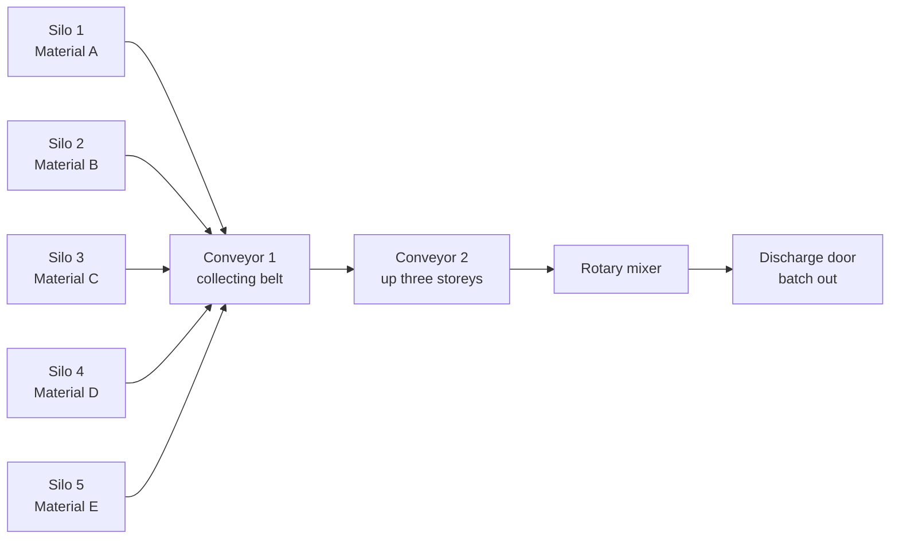

# Start here: how troubleshooting works

For newcomers: students, new maintenance technicians, or anyone curious. No experience needed. Words in **bold** are explained in the [glossary](GLOSSARY.md).

## 1. How an automated line is put together

Think of a car:

| In a car | On a factory line | In this lab |
|---|---|---|
| The engine computer | The **PLC**: a tough industrial computer that runs the machine, step by step, every tenth of a second | OpenPLC running `batching.st` |
| Sensors (speed, temperature) | **Sensors**: weighing cells, door switches, belt-speed switches | Simulated by the plant program |
| Engine, brakes, lights | **Actuators**: motors, **VFDs**, valves, gates | Simulated too |
| The dashboard | The **HMI**: the screen the operator and technician use | Two FUXA screens |
| The wiring loom | Cables, **I/O** cards and a network | A simulated **remote I/O** rack |

The PLC keeps repeating one simple loop: **read every input → decide → set every output**.

## 2. The plant in this lab

One batch goes like this:
1. The mixer starts.
2. Conveyor 2 starts, then conveyor 1. The belts start from the far end first, so material never piles up where one belt drops onto the next.
3. Each silo opens its gate and weighs out its ingredient, fast at first, then slowly at the end to hit the weight exactly.
4. The belts empty.
5. The mixer mixes for a set time.
6. The door opens and the batch comes out.

If anything goes wrong, the PLC **holds**: it shuts the gates, lets the belts empty and waits for a person.

## 3. The method: work like a doctor

A good doctor doesn't operate first and diagnose later. A good technician doesn't replace parts until something works, either.

| Step | Doctor | Technician | In the lab |
|---|---|---|---|
| 0 | Listen to the complaint | Read the **alarm** and the HMI: what stopped, and at which step? | Feeder or Mixer screen |
| 1 | Check vital signs | Check the **I/O**: are the inputs and outputs what this step expects? | OpenPLC → Monitoring |
| 2 | Read the medical history | Read the program **online**: which condition isn't met? | `batching.st` + Monitoring |
| 3 | Check the prescription | Check the **configuration**: addresses, settings, screen tags | Slave Devices, FUXA tags |
| 4 | Treat, then confirm recovery | Repair or replace, then **prove** it with a full batch | Reset, Resume, watch it run |

The order matters. Steps 0–3 cost minutes and touch nothing. Step 4 costs parts and downtime, so you do it last, and only once you know what's wrong.

## 4. Suggested order for the seven stories

From easiest to hardest:

1. **[F3, the conveyor that keeps tripping](../faults/F3-vfd-trip.md):** why "reset and hope" doesn't work.
2. **[F5, "open" but the door stays shut](../faults/F5-output-wiring.md):** following electricity from the controller to the device.
3. **[F1, a silo weighing minus 5 000 kg](../faults/F1-sensor.md):** how sensors fail, and why a strange number is a clue.
4. **[F4, the jammed gate](../faults/F4-gate-stepper.md):** motors that protect themselves and lose their position.
5. **[F2, everything freezes](../faults/F2-module-address.md):** communication faults, and checking settings after a part swap.
6. **[F7, the screen that lies](../faults/F7-hmi-tag.md):** check the source before believing the display.
7. **[F6, no alarm but the product is wrong](../faults/F6-program-edit.md):** the hardest kind: everything works, and the instruction is wrong.

Then read [real-plant conditions](../faults/REAL_WORLD.md): corrosion, dust, humidity and wear, which cause many of these faults in real life.

## 5. Try it yourself

| Level | What you need | What you get |
|---|---|---|
| **Read** | Nothing | The seven stories with screenshots |
| **Run the simulator** | A computer with Python 3.10+ | `python -m lab.run_softplc`: the whole plant and controller in one program; start batches and inject faults by typing commands |
| **Full lab** | Windows + WSL, about an hour of setup | OpenPLC + FUXA screens + simulator, exactly as in the screenshots. See [Setup](SETUP.md) |

## 6. Safety in real plants

This lab is a simulation, so you can't hurt anyone. Real plants are different:
- Only work on equipment you're **authorised and trained** for.
- **Lock out and tag out** (isolate the power and put your own lock on it) before touching machinery or wiring.
- Never bypass a safety device "just for a moment".
- The E-stop in a real plant is a **hardwired safety circuit**; the PLC only watches it. This lab is **not** a safety system.
