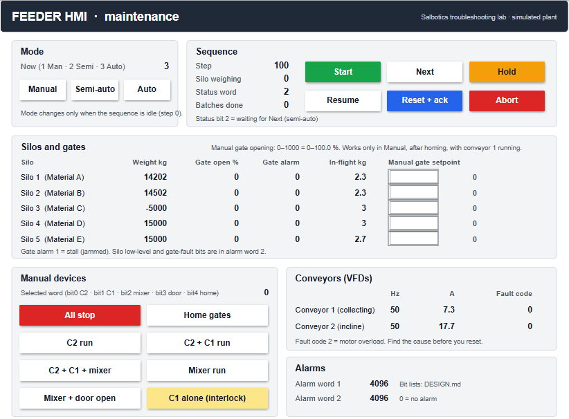

# F1 · Sensor: silo 3 weight signal lost

*[Back to the main page](../README.md) · [How troubleshooting works](../docs/START_HERE.md) · [Glossary](../docs/GLOSSARY.md)*

> **In plain words:** A silo's weighing sensor lost its signal because its cable broke, so the controller saw an impossible weight and safely paused the batch. The fix is the cable, not the program.

**Mirrors:** sensor checks on a production line. **Plant:** the silo 3 load-cell transmitter's 4–20 mA loop opens (a broken cable, or a corroded or loose junction-box terminal) while Material C is being weighed out.

**Inject:** `fault F1 on` at the simulator's `lab>` prompt, or `python3 tools/instructor.py F1 on`, while silo 3 is feeding. **Repair:** `fault F1 off`.

Screenshots: OpenPLC Runtime v3 + plant simulator + FUXA Feeder HMI, 2026-11-20.

## Walkthrough

### 1. Symptom: the batch holds, and silo 3 weighs −5000 kg



- **Sequence:** Step **100** (hold), status word 2.
- **Silos and gates:** silo 3 reads **−5000 kg**. A silo can't weigh less than nothing, which is the first clue. Every gate is closed.
- **Alarms:** alarm word 1 = **4096** (bit 12, weight signal fault); alarm word 2 = **4096** (bit 12, silo 3).

### 2. Check the I/O: the raw signal


- `IR_Weight3` = **0** raw counts. The other four silos read 24 578–25 600.
- Raw counts are mA × 1600: 0 counts = **0 mA**. A live 4–20 mA loop never reads below 4 mA (6 400 counts), so 0 mA means the loop is **open**.

### 3. Read the program online

Section 2 of `batching.st`:

```
SignalBad[i] := (RawW[i] < 5760) OR (RawW[i] > 32640);   (* below 3.6 mA or above 20.4 mA *)
WeightKg[i]  := INT_TO_REAL(RawW[i] - 6400) * 20000.0 / 25600.0;   (* 0 counts -> -5000 kg *)
```

`SignalBad[3]` is TRUE, so `A_Signal` latched and the sequence held. The −5000 kg is just the scaling applied to 0 mA. The program is doing its job; the fault is outside it.

### 4. Configuration

Nothing to change: the other four silos read normally on the same rack, so the rack and its scaling are fine. The fault is on this one channel.

### 5. Repair and prove


1. At the transmitter, put a meter in series with the loop: 0 mA confirms the open circuit. Check the cable and the junction-box terminals (in a corrosive plant, look for green or white corrosion on the terminals first).
2. Repair (lab: `fault F1 off`). Silo 3's weight returns to normal.
3. **Reset + ack**, then **Resume**.
4. **Result:** step **60**, silo **3** feeding at gate 100 %, alarm words 0. The batch carries on from the weight already dispensed, because the PLC kept silo 3's start weight through the hold.

## Summary

| | |
|---|---|
| **Symptom** | Batch holds while weighing Material C; silo 3 reads −5000 kg |
| **Online view** | `IR_Weight3` = 0 counts (0 mA); `SignalBad[3]` TRUE |
| **Cause** | 4–20 mA loop open: cable or a corroded junction-box terminal |
| **Fix** | Meter the loop, repair the wiring, Reset + ack, Resume |
| **Lesson** | A live-zero signal (4–20 mA) tells you the difference between *empty* and *broken*. Read the raw value before trusting the engineering value |
