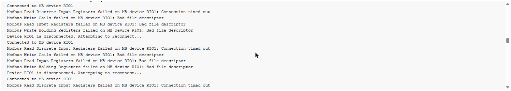
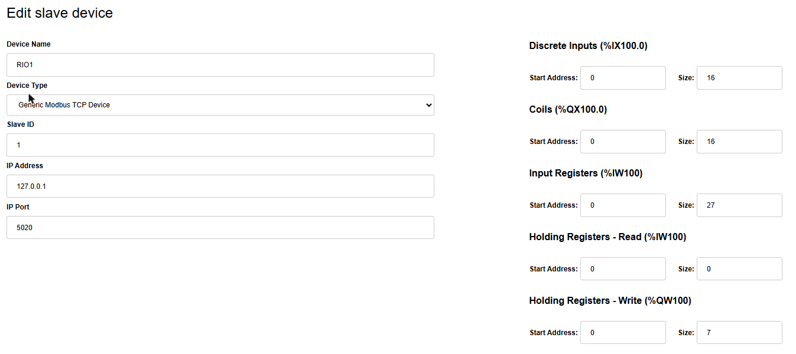
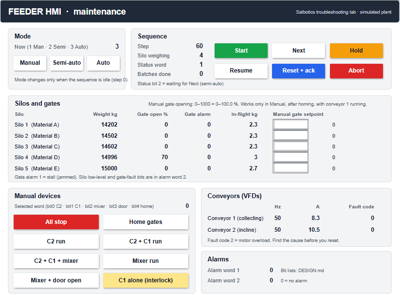

# F2 · Module configuration: remote I/O node address wrong

**Mirrors:** swapping an I/O module or card and checking its configuration (DIP switches). **Plant:** after a card swap, the remote I/O rack's node-address switches are set to **2**, but the master PLC polls node **1**.

**Inject:** `fault F2 on` (or `tools/instructor.py F2 on`) while a batch runs. **Repair:** `fault F2 off`.

Screenshots: OpenPLC Runtime v3 + plant simulator + FUXA Feeder HMI, 2026-11-20.

## Walkthrough

### 1. Symptom: everything stops, and the HMI freezes

- **Sequence:** Step **100**, alarm word 1 = **2** (bit 1, remote I/O comms lost).
- **The trap:** the HMI still shows gate 3 at **25 %** and conveyor 1 at **9.6 A**, but the belts have actually stopped. These are the **last values the PLC received** before it lost the rack. Every number on the screen is stale.

### 2. Check the I/O: is anything changing?

- The rack counts `IR_Heartbeat` up every 100 ms. Here it reads **7712**, and still 7712 four seconds later.
- When every input freezes at once, suspect the **communication or the module**, not a single sensor.

### 3. Read the program online and the PLC log

- Section 5 of `batching.st`: `HBSame := IR_Heartbeat = LastHB;` → 2 s timer `CommsTmr` → `A_Comms`. That's the alarm you saw.

- The OpenPLC dashboard log repeats: *"Modbus Read Discrete Input Registers failed on MB device RIO1: Connection timed out"* … *"Device RIO1 is disconnected. Attempting to reconnect…"*. The PLC is asking, and nobody answers.
- **The rack protected the plant on its own:** after 1 s with no master, it applied its fault action (outputs off, gate setpoints 0), so the gates closed and the belts stopped. That's why nothing spilled.

### 4. Configuration (this is the fault)

- The master's configuration for RIO1: **Slave ID 1**, 127.0.0.1, port 5020.
- The rack answers only its own node address. On real hardware you'd read it from the module's address switches; here, `fault F2 on` set the rack to **2**.
- **Mismatch found:** the replacement card wasn't set to match the configuration.

### 5. Repair and prove

1. Set the module's address back to 1 (lab: `fault F2 off`). The heartbeat counts again.
2. **Reset + ack**, then **Resume**. The sequence restarts the mixer, then conveyor 2, then conveyor 1 (downstream first), and carries on.
3. **Result:** step 60, feeding again, alarm words 0, nothing spilled.

## Summary

| | |
|---|---|
| **Symptom** | Everything stops; "remote I/O comms lost"; HMI values frozen |
| **Online view** | `IR_Heartbeat` stuck; OpenPLC log: Modbus reads to RIO1 time out |
| **Cause** | Node address on the replacement module ≠ the master's configuration |
| **Fix** | Set the address switches to match (1), Reset + ack, Resume |
| **Lesson** | When everything freezes at once, check the communication and module configuration before any sensor. After every module swap, check its address against the master's configuration |
