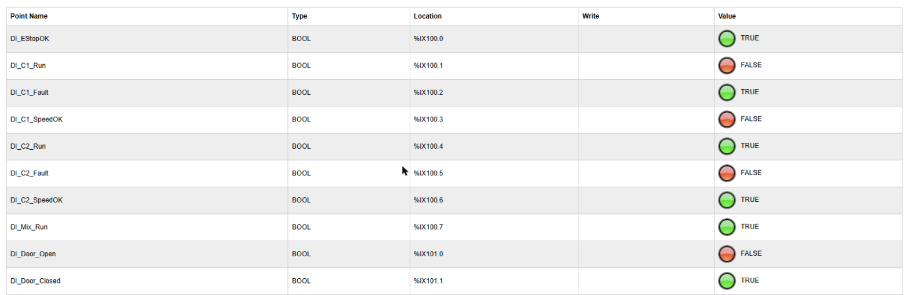
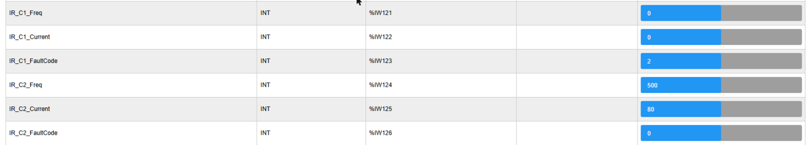
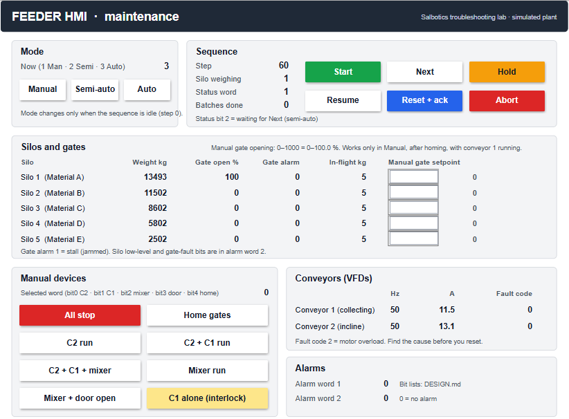

# F3 · VFD trip: conveyor 1 overload

**Mirrors:** checking VFDs / inverters. **Plant:** conveyor 1 drags (seized return idlers, belt rubbing). Empty, it just runs heavy; loaded, the drive trips on motor overload.

**Inject:** `fault F3 on` at the simulator's `lab>` prompt, or `python3 tools/instructor.py F3 on`. **Repair:** `fault F3 off` / `instructor.py F3 off`.

Screenshots: OpenPLC Runtime v3 running `batching.st`, FUXA Feeder HMI and the plant simulator, captured 2026-11-20.

## Walkthrough

### 1. Batch running, conveyor 1 already heavy

- **Sequence:** Step **60** (feeding), silo **1** weighing, gate 1 at 100 %.
- **Conveyors:** conveyor 1 draws **22.4 A**. Its rating is 20 A, and a healthy belt carrying this load draws about 11 A. The drive hasn't tripped *yet*.

> First clue: current well above normal *before* any alarm. Trend it and you'd catch the drag before the trip.

### 2. The trip

- **Sequence:** Step **100** (hold), status word 2 (held).
- **Conveyor 1:** 0 Hz, 0 A, **fault code 2 = motor overload**. Conveyor 2 keeps running (50 Hz) to empty itself, then stops.
- **Alarm word 1 = 4** (bit 2, conveyor 1 VFD trip).
- **Silos and gates:** every gate is at 0 %. The interlock shut them at once, because the PLC never feeds onto a stopped belt.

### 3. Check the I/O: the PLC's view (OpenPLC → Monitoring)

- `DI_C1_Fault` **TRUE**: the drive's fault relay is closed.
- `DI_C1_Run` and `DI_C1_SpeedOK` **FALSE**: the motor stopped and the belt isn't moving.
- `DI_C2_Run` and `DI_C2_SpeedOK` TRUE: conveyor 2 is still running out.

- `IR_C1_FaultCode` **2** (overload), `IR_C1_Freq` 0, `IR_C1_Current` 0. These are read from the drive over the remote rack.

### 4. Read the program online: is the PLC doing its job?

- Section 6 of `batching.st`: `IF DI_C1_Fault THEN A_C1Trip := TRUE;` latches the trip.
- Section 10: `C1Cmd := SeqC1 AND … NOT A_C1Trip` and the gate interlock (`IF NOT (C1Cmd AND DI_C1_SpeedOK) THEN` all gates 0).

The PLC reacted correctly. The question is **why the drive tripped**.

### 5. Test: reset without fixing

- Press **Reset + ack** (1 s reset pulse to the drive), then **Resume**.
- The belt restarts and silo 1 feeds again: its weight drops another 36 kg, from 13 895 to 13 859 kg. As soon as material loads the belt, the drive **trips again with the same fault code 2**, within seconds.

> An overload that comes back under load is mechanical. Resetting a drive doesn't fix a seized idler.

### 6. Repair and prove

1. Lock out the conveyor and find the drag: idlers, belt tracking, material build-up under the return run. Free it (lab: `fault F3 off`).
2. **Reset + ack**, then **Resume**.
3. The result:
   - Step **60** again, gate 1 at 100 %.
   - Conveyor 1 at **11.5 A** while loaded, about half the current before the repair.
   - Alarm words 0.
   - The batch carries on from the weight already dispensed and finishes Material A in tolerance.

## Summary

| | |
|---|---|
| **Symptom** | Conveyor 1 stops mid-feed; batch holds; fault code 2 |
| **Online view** | `DI_C1_Fault` TRUE, `IR_C1_FaultCode` 2; current 22.4 A against a 20 A rating before the trip |
| **Cause** | Mechanical drag (seized idlers), not an electrical fault |
| **Fix** | Free the drag, Reset + ack, Resume. Current back to about 11.5 A loaded |
| **Lesson** | A drive fault code tells you *how* it failed, not *why*. Never just keep resetting a drive: find the load that tripped it, and trend motor current so the next one is caught early |
