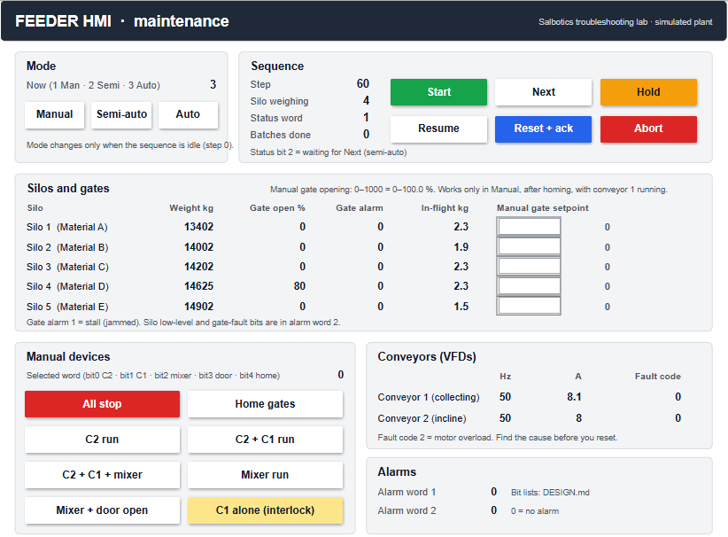

# F4 · Stepper drive: silo 4 gate jammed

*[Back to the main page](../README.md) · [How troubleshooting works](../docs/START_HERE.md) · [Glossary](../docs/GLOSSARY.md)*

> **In plain words:** A lump of material jammed one silo's gate. The gate's motor sensed it was stuck and stopped to protect itself. Clear the jam, and the machine re-learns the gate's position before carrying on.

**Mirrors:** checking stepper motors and drives. **Plant:** a lump of caked Material D jams the silo 4 gate blade. When the drive tries to open it, the motor stalls.

**Inject:** `fault F4 on` (or `tools/instructor.py F4 on`) before a batch. **Repair:** `fault F4 off`.

Screenshots: OpenPLC Runtime v3 + plant simulator + FUXA Feeder HMI, 2026-11-20.

## Walkthrough

### 1. Symptom: silos 1–3 fine, then the batch holds at silo 4

- **Sequence:** Step **100**; silos 1–3 have already weighed out.
- **Silos and gates:** gate 4 is stuck at **2 %**, with **gate alarm 1** (stall).
- **Alarms:** alarm word 1 = **512** (bit 9, gate drive fault); alarm word 2 = **256** (bit 8, gate 4).

### 2. Check the I/O: the drive's own report

| Tag | Value | Meaning |
|---|---|---|
| `IR_GatePos4` | **20** (0.1 %) | 2.0 %: it moved a little, then stopped |
| `IR_GateStatus4` | **8** (16#0008) | fault bit only. The healthy gates read **7** (ready + homed + in position); gate 4 lost "ready" and **"homed"** |
| `IR_GateAlarm4` | **1** | stall |

### 3. Read the program online

Section 2 reads bit 3 of each status word (`GateFault[i] := (GateStat[i] AND 16#0008) <> 16#0000`); section 6 latches `GateFaultSilo[4]` and `A_GateFault`. The PLC asked for fast feed (setpoint 1000 = 100 %); the drive couldn't follow.

### 4. Configuration / drive

- **The drive is healthy:** it detected the stall and protected the motor. The other four gates work, so it isn't power, enable or communications.
- **A stalled stepper loses its position**, which is why the homed bit dropped. It must be homed again before any position can be trusted.

### 5. Repair and prove

1. Isolate the drive and clear the jam at the gate (lab: `fault F4 off`).
2. **Reset + ack** (reset pulse to the gate drives), then **Resume**.
3. The sequence **homes the gates by itself** (step 12) before feeding. The jam is gone, so homing and opening both work.
4. **Result:** step 60, silo 4 feeding, gate 4 at 80 %, no alarms.

If the jam were still there, homing (closing) would succeed but opening would stall again. That tells you the blade is still blocked.

## Summary

| | |
|---|---|
| **Symptom** | Batch holds when Material D starts; gate 4 stuck at 2 % |
| **Online view** | `IR_GateStatus4` = 8 (fault, not homed), `IR_GateAlarm4` = 1 (stall) |
| **Cause** | Caked material jamming the gate blade |
| **Fix** | Clear the jam, Reset + ack, Resume (automatic re-homing first) |
| **Lesson** | Fix the mechanical cause, then re-home: a stalled stepper's position can't be trusted |
