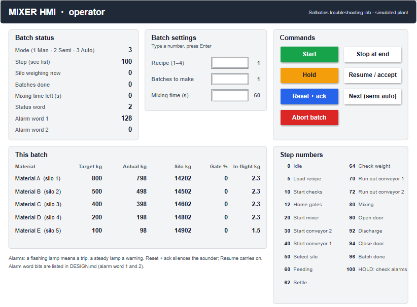
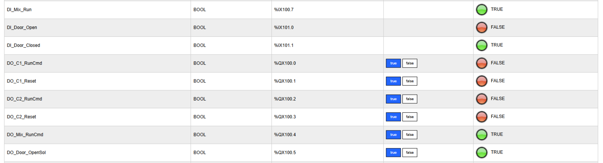
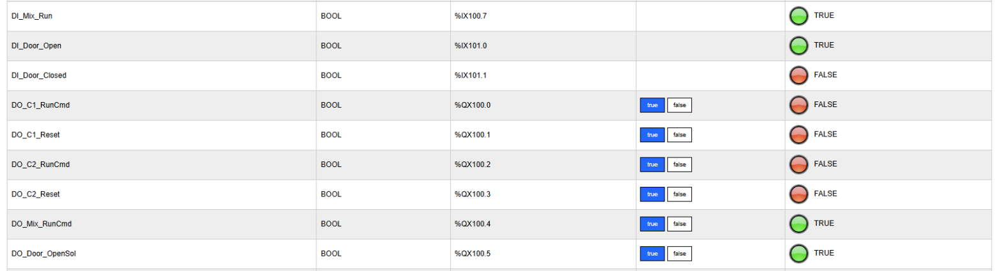

# F5 · Output on, device not moving: discharge door solenoid

**Mirrors:** the classic "the PLC says it's on, but nothing moves". **Plant:** the wire from the output card to the mixer's discharge-door solenoid valve is broken (or a terminal has corroded or come loose).

**Inject:** `fault F5 on` (or `tools/instructor.py F5 on`) before the end of a batch. **Repair:** `fault F5 off`.

Screenshots: OpenPLC Runtime v3 + plant simulator + FUXA Mixer HMI, 2026-11-20.

## Walkthrough

### 1. Symptom: mixing done, the door never opens

- **Sequence:** after mixing, step 90 (open door) runs for 10 s, then **step 100** (hold).
- **Alarms:** alarm word 1 = **128** (bit 7, discharge door open timeout).
- **This batch:** all five materials weighed (798 / 498 / 398 / 198 / 98 kg). The batch is safe in the turning mixer, but stuck.

### 2. Check the I/O (this finds it)

Captured while the door was trying to open:

| Tag | Value |
|---|---|
| `DO_Door_OpenSol` | **TRUE**: the output is on (on real hardware, the card's LED is lit) |
| `DI_Door_Open` | FALSE |
| `DI_Door_Closed` | **TRUE**: the door never left its closed switch |
| `DI_Mix_Run` | TRUE: the mixer keeps turning, as designed |

The command left the PLC, but no movement followed.

### 3. Read the program online

Step 90: `DoorCmd` TRUE → `DoorOpenTmr` (10 s) → `A_DoorOpenTO`. The logic is satisfied; the fault is **after the output terminal**.

### 4. Field check (real hardware)

With the output on:
1. **24 V at the output card terminal?** Yes → the PLC and the card are fine.
2. **24 V at the valve coil?** No → the fault is in the wire between them (in a corrosive plant, check the terminals first).
3. If 24 V *did* reach the coil, you'd check the valve, then the air supply, then the cylinder.

### 5. Repair and prove

1. Repair the wire (lab: `fault F5 off`).
2. **Reset + ack**, then **Resume**. After its restart checks (mixer running, door closed), the sequence returns to step 90.
3. **Result:** `DI_Door_Open` TRUE, `DI_Door_Closed` FALSE; step **92** (discharge), alarm words 0. The batch empties.

## Summary

| | |
|---|---|
| **Symptom** | Door-open timeout after mixing; batch stuck in the mixer |
| **Online view** | `DO_Door_OpenSol` TRUE, `DI_Door_Open` FALSE, `DI_Door_Closed` TRUE |
| **Cause** | Broken wire or corroded/loose terminal between the output card and the valve |
| **Fix** | Follow the 24 V from the card to the coil, repair, Reset + ack, Resume |
| **Lesson** | When the output is on and the device isn't moving, follow the voltage. The fault is wherever it stops |
