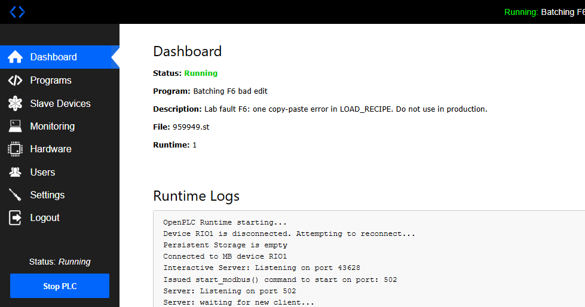
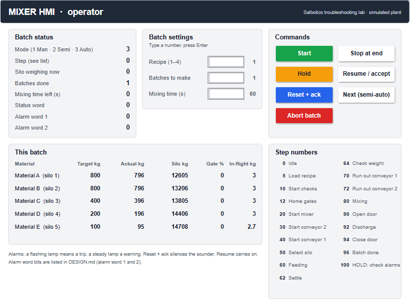
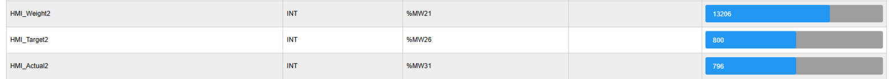
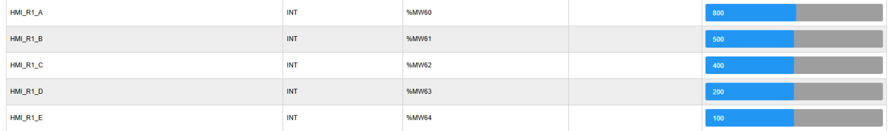

# F6 · Program edit: a copy-paste error in the recipe

*[Back to the main page](../README.md) · [How troubleshooting works](../docs/START_HERE.md) · [Glossary](../docs/GLOSSARY.md)*

> **In plain words:** A small copy-paste mistake in a program change made the machine put in too much of one ingredient. There's no alarm, because the machine did exactly what it was told. Comparing with the last good version finds it.

**Mirrors:** editing and downloading PLC programs. **Plant:** someone edited the recipe-loading section "to fix silo 2", copied the line above and forgot to change the index. It was downloaded without comparing it to the last good backup.

**Inject:** in OpenPLC, **Programs → Upload Program** → `plc/faults/F6_batching_bad_edit.st`, then Start PLC. In the soft-PLC: `python -m lab.run_softplc --f6`. **Repair:** load `plc/batching.st` again (OpenPLC keeps both in its program list).

Screenshots: OpenPLC Runtime v3 + plant simulator + FUXA Mixer HMI, 2026-11-20.

## Walkthrough

### 1. The program that's running



On a real line you wouldn't know an edit had been made. This is here so the reader can follow along.

### 2. Symptom: no alarm, but the batch is wrong



- The batch ran start to finish: **batches done 1, alarm words 0**.
- **This batch:** Material **B: target 800 kg, actual 796 kg**. Recipe 1 calls for 500 kg of B.
- The batch is about 2 280 kg instead of about 2 000 kg, with ~300 kg too much Material B. On a real line, quality would find it downstream, not the PLC.

### 3. Check the I/O

All I/O is healthy: silo 2 weighed out exactly what the PLC asked for (796 kg for a target of 800). The weighing system worked; **the request was wrong**.

### 4. Read the program online: where does the target come from?





- `HMI_Target2` (%MW26) = **800**, but `HMI_R1_B` (%MW61) = **500**.
- The target is set in step 5 (LOAD_RECIPE). In the running program:

```
TargetKg[1] := RecipeKg[RecipeBase + 1];
TargetKg[2] := RecipeKg[RecipeBase + 1];   (* edited 'to fix silo 2' *)   <- should be + 2
```

### 5. Configuration / version control

Compare the running program with the last known-good copy:

```
git diff --no-index plc/batching.st plc/faults/F6_batching_bad_edit.st
```

Exactly one logic line differs (`tests/test_st_consistency.py` checks this too).

### 6. Repair and prove

1. Load the good program (OpenPLC: **Programs** → *Batching v2* → **Launch program**; stop the PLC first), then **Start PLC**.
2. Run one test batch: the targets match the recipe again (800 / 500 / 400 / 200 / 100).

## Summary

| | |
|---|---|
| **Symptom** | No alarm; batches come out off-ratio (silo 2 = 800 kg instead of 500 kg) |
| **Online view** | `HMI_Target2` 800 ≠ `HMI_R1_B` 500; `TargetKg[2] := RecipeKg[RecipeBase + 1]` |
| **Cause** | Copy-paste edit downloaded without a compare against the backup |
| **Fix** | Diff against the last good program, restore, download, test batch |
| **Lesson** | The PLC does exactly what it's told. Compare every edit with the last good backup, and run a test batch before production |
