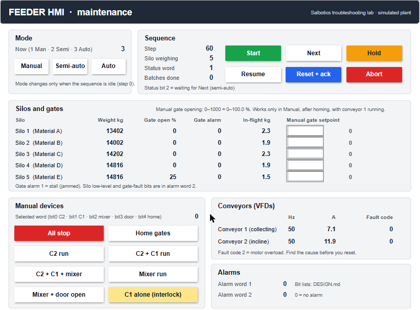
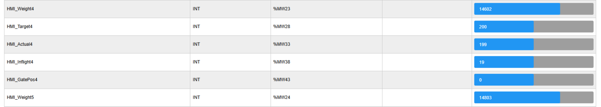

# F7 · HMI change: a tag pointing one register too far

*[Back to the main page](../README.md) · [How troubleshooting works](../docs/START_HERE.md) · [Glossary](../docs/GLOSSARY.md)*

> **In plain words:** A typing slip in the operator screen's settings made it show the wrong silo's weight, so a healthy silo looked like it was leaking. The controller had the right number all along.

**Mirrors:** making HMI changes. **Plant:** while editing the Feeder HMI, someone typed the "silo 4 weight" tag address one too high. FUXA counts addresses from 1 and the PLC map from 0, so off-by-one mistakes are easy.

**Inject:** in FUXA → Connections → BatchPLC → tag `Weight4`, change the address offset from **1048** to **1049**. **Repair:** set it back to 1048, or regenerate all tags with `python hmi/make_fuxa_device.py --plc 127.0.0.1:502`.

Screenshots: OpenPLC Runtime v3 + plant simulator + FUXA Feeder HMI, 2026-11-20.

## Walkthrough

### 1. Symptom: "silo 4 is leaking"

- **Silo 5** is feeding (gate 5 at 25 %, silo weighing 5).
- **Silo 4's weight falls with it:** 14 816 → 14 809 kg in 5 s, while **gate 4 is at 0 %** and has no alarm.
- No alarm. It looks like gate 4 is leaking, and someone could spend an hour on the wrong gate.

### 2. Check the I/O

Gate 4 is closed with no alarm; gate 5 is open. Nothing on site explains silo 4 losing weight.

### 3. Read the program online: the PLC is right

- `HMI_Weight4` (%MW23) = **14 602 kg, steady**: the real silo 4.
- `HMI_Weight5` (%MW24) = **14 803 kg**: what the HMI was showing as "silo 4".

So the HMI's "silo 4" is really reading %MW24.

### 4. Configuration (this is the fault)

- `hmi/fuxa-tags.csv`: `Weight4` = %MW23 = register 1047 (0-based) = **FUXA offset 1048**. The tag says **1049**: register 1048 = %MW24 = silo 5.
- **The check to use on every HMI change:** change one PLC value at a time and watch which display moves. In the lab, `refill 4 9000` at `lab>` changes the real silo 4, and the wrong tag doesn't move.

### 5. Repair and prove

1. Set `Weight4` back to offset 1048 (or regenerate the tags from the map).
2. **Result:** silo 4 reads **14 602 kg** and silo 5 **14 803 kg**, matching the PLC.

## Summary

| | |
|---|---|
| **Symptom** | No alarm; HMI shows silo 4 dropping while silo 5 feeds |
| **Online view** | PLC `HMI_Weight4` steady at 14 602 kg; the HMI number matches `HMI_Weight5` |
| **Cause** | Off-by-one tag address (1049 instead of 1048): 0-based vs 1-based numbering |
| **Fix** | Correct the address; verify by moving one value at a time |
| **Lesson** | Check the PLC before believing the HMI. Test every HMI change by moving one value and watching which display follows |
